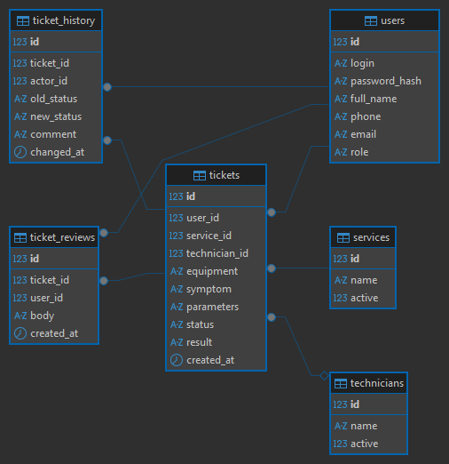
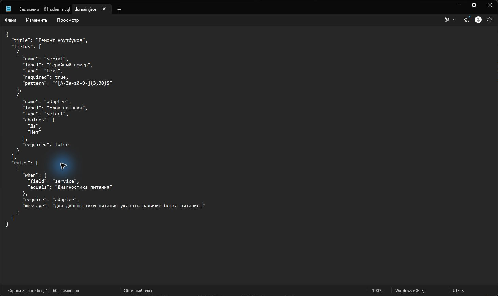
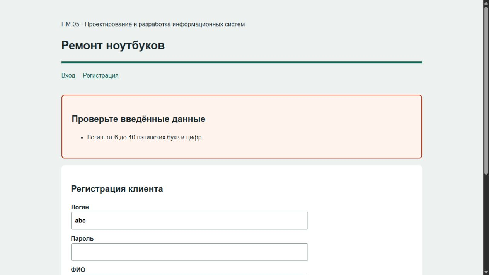
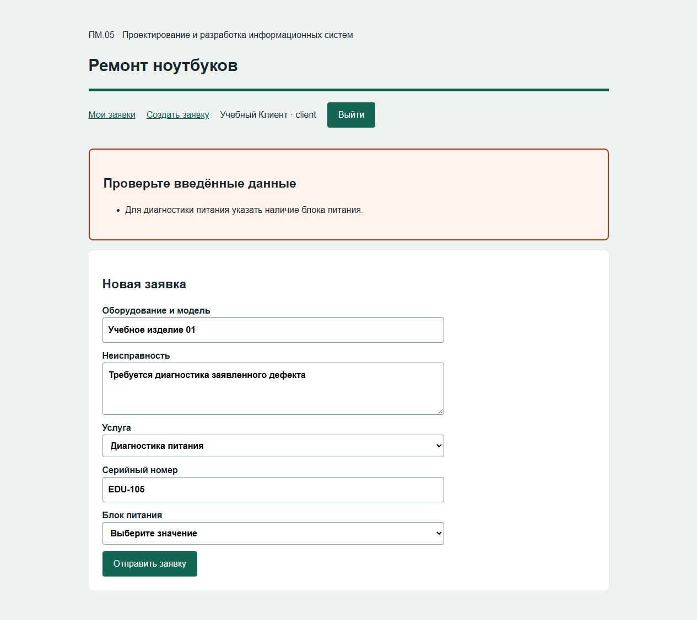
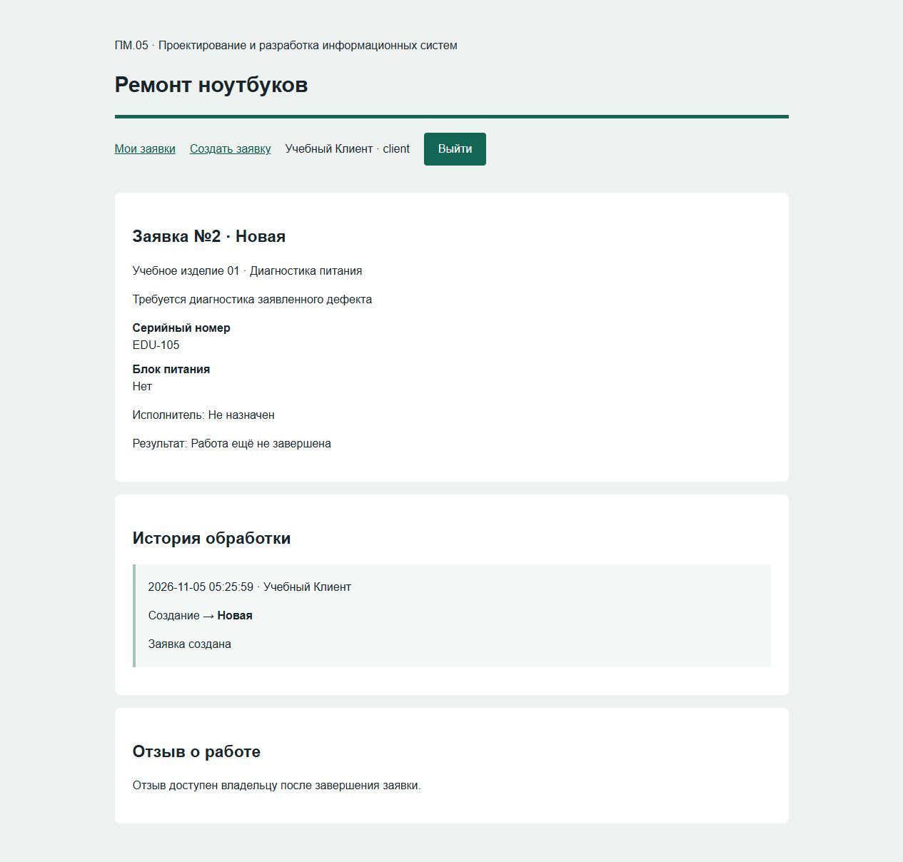
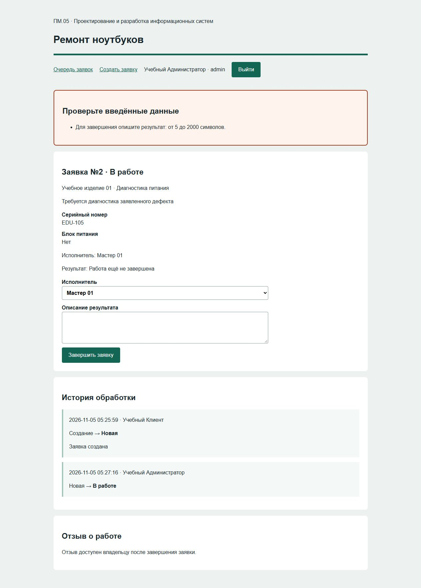
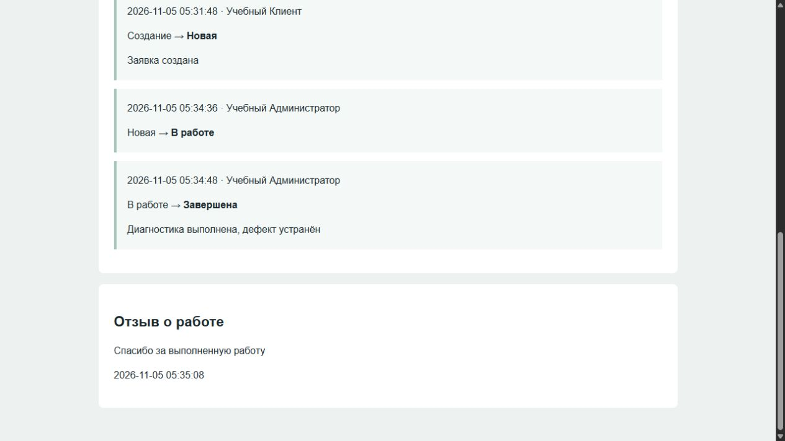

# Задание и методические рекомендации

## 1. Полное задание

### Результат и выбор среды
Разработать один серверный проект сервисной организации назначенного варианта: MySQL или MariaDB и одну ветку — Flask либо PHP. Выполнить проектирование данных, регистрацию, вход и выход, создание и просмотр своих заявок, административную обработку, историю и отзыв. Выбор ветки зафиксировать до создания файлов. Демонстрационный сервис учебной техники служит объяснением; отдельный проект демонстрации сдавать не требуется. Использовать предоставленную минимальную оболочку, сохранив её доступные подписи и сообщения.

### Исходные условия и данные
Получить номер у преподавателя и открыть его карточку в отдельном списке. Использовать только собственный набор vNN: поля, услуги, исполнители, корректный и ошибочный случай. Создать отдельную БД, ER-диаграмму и один рабочий каталог. users, services, technicians, tickets, ticket_history и ticket_reviews отражают пользователей, услуги, исполнителей, заявки, события и отзывы. Клиент и администратор — разные роли. Предметные значения хранить в parameters; основные сущности, ссылки, статус и даты — в типизированных столбцах. Объяснить границы модели и каждую связь.

### Регистрация и вход
Реализовать обязательные поля: уникальный логин из 6–40 латинских букв/цифр, пароль от 8 символов и не более 64 байт UTF-8, ФИО из кириллицы/пробелов длиной 3–120, телефон 8(XXX)XXX-XX-XX и email до 120 символов. Сохранять хеш пароля, выполнять параметризованные запросы. Показывать сообщения при отказе; не возвращать введённый пароль в форму. Предусмотреть ссылки между регистрацией и входом, выход и проверку сессии на каждом защищённом действии.

### Заявка и принадлежность
Реализовать оборудование/изделие длиной 3–120 символов, симптом/описание длиной 5–2000, действующую услугу и предметные поля варианта. Реализовать собственное условие на сервере до INSERT. Отправлять заявку только от пользователя текущей сессии; подставленные user_id, role и status не определяют владельца, роль или начальный статус. Клиенту показывать только свои записи, включая фильтр и прямой адрес карточки. Доступ к чужой карточке возвращает 404, клиентское изменение статуса — 403.

### Административная обработка и отзыв
Реализовать последовательность Новая → В работе → Завершена. Для каждого перехода требовать действующего исполнителя; для завершения — результат длиной 5–2000. Блокировать повторный и обратный переход. Заявку и событие истории сохранять одной транзакцией; изменение блокировать SELECT FOR UPDATE. Отклонённая операция не добавляет событий. Отзыв длиной 5–1000 допускается один раз только владельцу завершённой заявки: ранний и повторный запрос — 409, чужой — 404, неверная длина — 400, администратор не пишет клиентский отзыв.

### Проверки и собственное изменение
Проверить не только браузер: выполнить прямые HTTP-запросы, которые обходят required и списки. До каждого отказа записать ожидаемое сообщение/код и число записей, после — факт и неизменность данных. Проверить границы регистрации, дубликат логина, ошибочный пароль, CSRF, недействующую услугу/исполнителя, собственную и чужую заявку, оба перехода, отзыв и точную историю. Для правила варианта выполнить ошибочный, корректный и собственный соседний случай; объяснить условие, исправление и повтор. Повторить цикл на новой пустой БД. Для выбранной ветки выполнить все GUI-действия: открытие файлов, редактирование, сохранение, формы, ошибки, восстановление и выход.

### Передача и сдача
Представить работающий проект, ER-диаграмму, SQL-схему и вымышленные начальные справочники, описание запуска без секретов, таблицу серверных маршрутов/полей/ответов, журнал проверок и Git-историю начала и завершения. Заполнить чистый «Отчет о выполнении.docx» своими данными и рисунками; вставить в него доступную проверяющему ссылку своего репозитория. Подготовить официальные формы из карточки: договор, индивидуальное задание, аттестационный лист, справку и предусмотренные пояснительную/презентацию. Все результаты и документы сверить перед сдачей. Баллы и распределение часов в этот комплект не включаются.

## Сопоставление с образцом ДЭ

### Общий механизм
КИМ 09.02.07-3-2027, том 1, с.33–36: портал «Конференции.РФ» принимает бронирования помещений. Здесь выполнена учебная сервисная адаптация: помещение → услуга и изделие; дата конференции и способ оплаты → предметные сведения варианта. Это разные предметные модели; сервис не объявляется полным решением официального задания. Регистрационные ограничения КИМ сохранены; верхние границы введены для определённости хранения.

### Статусы и дополнительные условия
В КИМ: «Новая», «Мероприятие назначено», «Завершено»; администратор может сменить начальный статус на один из двух последующих. В сервисе: «Новая», «В работе», «Завершена»; здесь обязательны два последовательных перехода и назначение исполнителя. История, транзакции, однократный отзыв и CSRF — дополнительные условия текущей практики. Смысл отзыва после завершения соответствует с.36 КИМ. Учебный администратор создаётся отдельно; опубликованная экзаменационная пара логин/пароль в проект не переносится.

### Границы работы
Разработать минимальный интерфейс для проверки серверных действий. Графическую систему, анимацию и художественные ресурсы не требуется проектировать в этой работе. Все исходные материалы текущей практики самостоятельны; результат другой практики для начала не нужен.

## 2. Файлы и выбранная ветка

### Что получить
Сначала открыть отдельный список и скачать только vNN.zip своего номера. Распаковать его в новую папку: domain.json — поля без готового решения зависимого правила; schema.sql — пустые таблицы и собственные справочники; case.json — данные допустимого и ошибочного запроса; README.md — пояснение. Не менять данные на демонстрационные. Затем скачать только Flask или PHP. Архив выбранной ветки содержит рабочий образец для чтения и минимальную оболочку; серверную реализацию собрать и объяснить для своей области. Полные листинги показывают один путь решения, собственное правило и соседний проверочный случай выполняются самостоятельно. Перенос строки при чтении PDF не меняет строку исходного файла: для запуска использовать файлы выбранного архива, а не копию текста с переносами страниц.

### Отдельный список предметных областей
[Отдельный список предметных областей](https://raw.githubusercontent.com/OlgaKraven/2026-2027-09.02.07-rvmp-pp-pm.05-sem07/main/site/downloads/guide.pdf)

### Инструкция и исходники Flask
[Инструкция и исходники Flask](https://raw.githubusercontent.com/OlgaKraven/2026-2027-09.02.07-rvmp-pp-pm.05-sem07/main/site/downloads/flask.zip)

### Отдельная инструкция Flask
[Отдельная инструкция Flask](https://raw.githubusercontent.com/OlgaKraven/2026-2027-09.02.07-rvmp-pp-pm.05-sem07/main/site/downloads/flask.pdf)

### Инструкция и исходники PHP
[Инструкция и исходники PHP](https://raw.githubusercontent.com/OlgaKraven/2026-2027-09.02.07-rvmp-pp-pm.05-sem07/main/site/downloads/php.zip)

### Отдельная инструкция PHP
[Отдельная инструкция PHP](https://raw.githubusercontent.com/OlgaKraven/2026-2027-09.02.07-rvmp-pp-pm.05-sem07/main/site/downloads/php.pdf)

### Тестовый проект серверных проверок
[Тестовый проект серверных проверок](https://raw.githubusercontent.com/OlgaKraven/2026-2027-09.02.07-rvmp-pp-pm.05-sem07/main/site/downloads/tests.zip)

### Чистая форма отчёта Word
[Чистая форма отчёта Word](https://raw.githubusercontent.com/OlgaKraven/2026-2027-09.02.07-rvmp-pp-pm.05-sem07/main/site/downloads/Отчет%20о%20выполнении.docx)

### Как выбирать
Flask: продолжить по flask.pdf, папка flask и порт 5057. PHP: продолжить по php.pdf, папка php и порт 8057. Второй архив и вторую инструкцию не выполнять. Общая методика ниже применяется после запуска выбранной ветки. Файлы Office официального назначения скачиваются в пакете своей группы из действующей карточки практики.

## 3. Начало одного проекта

### Распаковка и структура
В браузере открыть ссылку своего набора, сохранить ZIP, в Проводнике открыть «Загрузки», правой кнопкой по архиву → «Извлечь всё». Указать новую папку service-vNN. Так же извлечь архив выбранной ветки. В service-vNN должны лежать свои domain.json и schema.sql и только выбранная папка flask либо php. Скопировать из выбранного архива минимальный шаблон templates/static для Flask либо view.php/style.css для PHP. Код обработчиков создавать по инструкции этой ветки сразу для своей области. В «Вид → Показать» включить расширения файлов; app.py.txt не является app.py.

### Редактор и UTF-8
Открыть domain.json в текстовом редакторе через «Файл → Открыть». Проверить title и список полей своего номера. Имена name используются в форме, обработчике и case.json одинаково. Сохранять Ctrl+S в UTF-8. В Python JSON явно читать read_text(encoding="utf-8"): системная кодировка Windows может изменить кириллицу и нарушить сравнение услуги. Не менять значения при сохранении и не добавлять комментарии внутрь JSON.

## 4. База данных и ER

### Новое подключение DBeaver
Запустить имеющийся MySQL/MariaDB. В DBeaver выбрать «База данных → Новое соединение → MySQL» (для MariaDB — соответствующий драйвер), Далее. Ввести Host 127.0.0.1, Port своего учебного сервера (обычно 3306), имя выданного пользователя и пароль; пароль не переносить в Git. Нажать «Тест соединения», затем «Готово». Если соединение не создано, проверить работающий сервер, порт, пользователя и доступ; не продолжать импорт с ошибкой подключения. Параметры в DB_HOST/DB_PORT/DB_USER/DB_PASSWORD приложения должны совпасть с этим подключением.

### Создание пустой базы в SQL-редакторе
```
CREATE DATABASE pm05_vNN CHARACTER SET utf8mb4;
USE pm05_vNN;
```

### Импорт и проверка
В навигаторе правой кнопкой по соединению → «SQL-редактор → Новый SQL-скрипт». Выполнить создание базы, заменив NN на свой номер. Открыть свой schema.sql через «Файл → Открыть файл», выбрать это соединение и базу; выполнить весь скрипт Alt+X. Ошибка «table already exists» означает непустую базу: создать другую пустую БД, прежние данные не удалять. Обновить навигатор F5. Открыть services и technicians → «Данные»: должны быть две собственные услуги и два исполнителя. users и tickets изначально пусты.

### Диаграмма и связи
Выделить свои шесть таблиц в навигаторе DBeaver, правой кнопкой → «Создать новую диаграмму». Ввести название, оставить выделенными шесть своих таблиц и нажать «Готово». Проверить линии внешних ключей: tickets → users/services/technicians, ticket_history → tickets/users, ticket_reviews → tickets/users. Связь ticket_reviews.ticket_id уникальна: один отзыв на заявку. Экспортировать диаграмму кнопкой «Сохранить диаграмму во внешнем формате» в нижней панели. Выбрать PNG и путь, нажать «Сохранить»; в вопросе об открытии допустимо выбрать «Нет». Сохранить в рабочую папку. Для отчёта сохранить собственную ER и объяснить обязательные ссылки; JSON parameters содержит только предметные свойства, а не заменяет users или services.

### Связи собственной модели


## 5. Реализация правила своего варианта

### Допустимый и ошибочный вход
Открыть case.json своего набора. valid — допустимые значения формы, invalid — значения, которые требуется отклонить. До написания правила сформулировать условие словами. Для образца: если service равно «Диагностика питания», adapter должен содержать «Да» или «Нет»; пустая строка не допускается. «Нет» — полноценный ответ, его нельзя считать отсутствием значения. В своём проекте взять поля и строку услуги из своих файлов.

### Три формы условия в domain.json
```
"rules": [
  {"when":{"field":"service","equals":"Диагностика питания"},
   "require":"adapter",
   "message":"Указать наличие блока питания."}
]

// Совместимость (пример формы объекта, комментарий не копировать в JSON):
{"when":{"field":"service","equals":"Замена лампы"},
 "expect":{"field":"light","equals":"Лампа"},
 "message":"Нужен ламповый источник света."}
```

### Диапазон, справочник и шаблон
Условная обязательность: when+require. Совместимость: when+expect. Для диапазона указать в fields type number либо integer, min и max; integer отвергает дробь. Для строго положительного измерения использовать минимальную принятую точность: 0,1 дюйма или 0,01 кг/мм, как в карточке. Для набора значений использовать choices; неизвестная строка должна отклоняться сервером. Для номера из букв/цифр — pattern с ^ и $; ^[A-Za-z0-9]{1,30}$ ограничивает весь номер. Required проверяет пустую строку, не смысловую совместимость. Удалить из рабочего JSON поясняющие комментарии примера. Сохранить файл и перезапустить Flask; PHP перечитывает его при запросе.

### Собственное изменение
Сначала выполнить invalid: при пустом rules зависимое правило ещё может пропустить ошибку. Записать это как обнаруженный дефект; затем самостоятельно заполнить объект правила и повторить те же значения. Диапазоны и choices уже заданы как исходные ограничения — проверить их и добавить один собственный соседний случай. Изменять только свой проект; файлы демонстрации не являются второй работой.

### Редактирование условия


## 6. Проверка клиента в браузере

### Регистрация и ошибка
После запуска открыть /register (Flask) или index.php?page=register (PHP). Ввести client01, учебный пароль Practice123, ФИО «Учебный Клиент», телефон 8(999)123-45-67, client@example.test. Сначала укоротить логин до abc и отправить. Ожидается сообщение и отсутствие пользователя в users. Исправить логин: появится вход. Повторная регистрация client01 должна вернуть сообщение о занятом логине. Ввести неверный пароль, увидеть отказ, затем исправить и войти.

### Ошибка и восстановление заявки
Нажать «Создать заявку». Ввести equipment/symptom из своего case.json, выбрать услугу и остальные valid-поля, затем заменить изменённое поле значением invalid. Нажать «Отправить заявку»: сервер показывает ошибку, число tickets и ticket_history не меняется, остальные введённые поля сохраняются. Исправить только ошибочное значение, повторить отправку: откроется новая карточка. Записать её номер из адреса и проверить поля/статус «Новая». Открыть «Мои заявки», применить фильтр «Новая», затем «Завершена» и «Все»: состав должен соответствовать статусу.

### Второй клиент и прямой адрес
Выйти кнопкой «Выйти», зарегистрировать client02 с другими вымышленными данными и войти. Список не содержит заявку client01. В адресной строке открыть записанный URL первой карточки: ожидается 404 без её содержания. Вернуться к своему списку. Это проверяет прямой доступ, а не только скрытую ссылку. После выхода защищённые страницы должны требовать вход.

### Серверный отказ регистрации


### Отказ предметной проверки


### Допустимый ответ «Нет»


### Прямой запрос другого клиента


## 7. Администратор и завершение

### Создание администратора
В выбранной инструкции выполнить create-admin один раз на новой базе, задать adminpm05 и вымышленный пароль от 8 символов. Через браузер войти этим пользователем: появляется «Очередь заявок», видны заявки обоих клиентов. Нажать первую карточку. Попытаться принять без исполнителя — сообщение об обязательном выборе; событие истории не добавляется. Выбрать действующего мастера и «Принять в работу»: статус «В работе», в истории создание и один переход.

### Запрет пустого результата и восстановление
Нажать «Завершить заявку» при пустом описании результата. Ожидается ошибка, статус остаётся «В работе», история прежняя. Ввести «Диагностика выполнена, дефект устранён» и повторить: статус «Завершена», история ровно из трёх событий. Проверить фильтр очереди. Повторный или обратный переход из прямого запроса не разрешён. Число событий и авторов сверить в SQL, а не по одному заголовку страницы.

### Завершение без результата отклонено


### Поле описания результата


### Три успешных события


## 8. Отзыв владельца

### Условие доступа
До завершения в карточке нет формы отзыва; показана причина. После завершения выйти из admin, войти client01 и открыть свою завершённую карточку. Появится textarea «Отзыв». Ввести «Спасибо за выполненную работу» и сохранить. Отображается один отзыв; повторная форма отсутствует. Заново открыть карточку — отзыв остаётся. Через client02 та же карточка и попытка отзыва недоступны.

### Что проверяется на сервере
Скрытие формы не ограничивает HTTP-запрос. Выбранная ветка проверяет сессию, роль клиента, владельца и статус под блокировкой строки, длину и отсутствие прежнего отзыва; затем INSERT. Уникальность ticket_id в таблице дополняет эту проверку. Для раннего/повторного запроса ожидать 409, чужого — 404. Короткий отзыв проверяется отдельно прямым запросом, обходящим minlength браузера.

### Сохранённый отзыв


### Тот же серверный результат PHP


## 9. Прямые запросы и состояние БД

### Тестовый проект
Распаковать tests.zip отдельно. Открыть README.md: он перечисляет назначение каждого случая и точную команду для Flask/PHP. Указать URL запущенного своего проекта и путь к case.json. Тесты создают вымышленные учётные записи и заявки; использовать отдельную проверочную БД. Положительные тесты не отменяют ручное заполнение и обход всех страниц. При отказе сначала сопоставить строку теста с собственным SQL-состоянием, исправить сервер и повторить ту же команду.

### Снимки данных до и после отказа
```
SELECT COUNT(*) AS tickets_count FROM tickets;
SELECT COUNT(*) AS history_count FROM ticket_history;
SELECT COUNT(*) AS reviews_count FROM ticket_reviews;
SELECT id,user_id,status,technician_id,result FROM tickets ORDER BY id;
SELECT ticket_id,actor_id,old_status,new_status FROM ticket_history ORDER BY id;
```

### Запрос в инструментах разработчика
F12 в браузере → Network/Сеть, отправить корректную форму, выбрать POST → Payload/Данные формы и Response/Ответ. Сверить имена полей и статус. Для учебного прямого запроса открыть Console/Консоль на этой же странице и выполнить пример из выбранной инструкции с текущим csrf. Браузерные required не исполняются при fetch. Не публиковать cookie и токены сессии. Ожидания и факты хранить в отчёте, а не угадывать по цвету сообщения.

## 10. Чистый повтор и сдача

### Новая база
Завершить прежнюю сессию кнопкой «Выйти». Создать отдельную БД pm05_vNN_recheck через DBeaver, импортировать свой schema.sql и выбрать её в DB_NAME. Прежнюю базу не удалять. Создать администратора, запустить выбранный сервер на другом свободном порту и повторить регистрацию, своё правило, два перехода, отзыв и чужой доступ. Ошибка подключения: проверить совпадение переменных с подключением DBeaver; ошибка занятого порта: завершить только свой прежний процесс Ctrl+C либо выбрать другой порт. После запуска проверить журнал терминала и пустой список нового клиента: адрес сам по себе не доказывает, что открыт новый процесс. Если прежний сервер ещё работает, остановить именно его и повторно открыть адрес. При смене базы использовать новую сессию браузера. Не использовать чужую рабочую базу для тестов.

### Репозиторий и инструкция
Из папки проекта выполнить git init, настроенное имя/почту проверить git var GIT_AUTHOR_IDENT. Добавить .gitignore с .venv/, __pycache__/, .env и *.log. Выполнить первый commit явно выбранных исходников. После реализации и проверок сделать итоговый commit. Создать репозиторий в своей учётной записи, добавить origin и отправить свою ветку. Реальные пароли и локальные БД не добавлять. В README указать версии инструментов, переменные без секретов, импорт schema.sql, создание admin, запуск и адрес, собственные данные проверки и ограничения. Таблица контракта из выбранной инструкции должна соответствовать фактическим маршрутам.

### Документы и самопроверка
В чистом отчёте заполнить три основных раздела. Вставить собственные рисунки по подписям: исходные данные/ER, регистрация с ошибкой и исправлением, клиент/чужой доступ, администратор и история, отзыв, прямые запросы, чистый запуск. Таблица проверок содержит вход, ожидаемое, фактическое, код и состояние данных. Вставить ссылку своего репозитория в раздел сдачи, проверить доступ. Официальные документы заполнить по формам своей группы и организации; не заменять их учебным бланком. Открыть презентацию и просмотреть каждый слайд. Проверить скачанный комплект, имена и отсутствие чужих данных.
